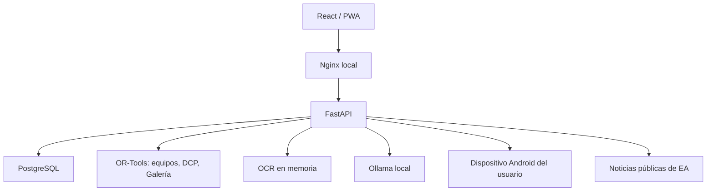

# Mapa técnico · Club Lab FC27

Perfiles de vista previa (21-oct-2026): `extension/lib/profile-extraction.ts` valida definiciones vinculadas a mapas, campos por vista, localizadores únicos por registro y pruebas por revisión; el panel permite editar/importar, probar, contrastar y activar lectura manual sin ingesta. Reutiliza `inspect-region.ts`; `privacy.ts` distingue tokens del juego y credenciales y el inspector informa omisiones. No cambia API, esquema ni admisión de páginas reales. Estado personal comprobado: frontend/API `ad73edf`, esquema `0018`, en 8090. [Alcance y pendientes](VIEW_RECOGNITION.md).

Reconocimiento guiado (18-oct-2026): [VIEW_RECOGNITION.md](VIEW_RECOGNITION.md), `extension/lib/inspect-region.ts`, `view-profile.ts` y `compatibility.ts`. Inspector privado independiente del backend, borradores declarativos y comprobación de builds/contrato; `/reader/capabilities` es una consulta pública limitada por Host/Origin. No cambia esquema, admisión ni origen de inventario. Mi cuenta guía hacia el permiso temporal del panel; `lib/official-tab.ts` reutiliza la pestaña abierta por la SPA.

Ampliación del 18-oct-2026, head **0018**: `extension/` (MV3/WXT), `models/reader.py`, `schemas/reader.py`, `api/reader.py` y `StructuredReader`: emparejamiento, recibos idempotentes y revisión por lote dentro del contexto asistido. No hay extractor EA real contrastado. [Instalación, contratos y matriz](ASSISTED_READING.md).

Galería v2: `schemas/fc27.py`, `services/gallery_v2.py` (CP-SAT/comprobador), `services/gallery_route.py`, `schemas/gallery_planning.py`, `api/gallery_planning.py`, `GalleryScenarioEditor` y `GalleryRoute`. Las reglas v1 no se convierten. `api/club_utilities.py` reutiliza `ClubProgress` para `/dcp/templates` y `/objective-journal`; no modifica progreso EA. Rutas nuevas de Galería: `/local-scenarios`, `/route-preview`, `/sets/{id}/declared-progress`.

Lectura asistida: [ASSISTED_READING.md](ASSISTED_READING.md), `models/assisted.py`, `schemas/assisted.py`, `services/assisted.py`, `services/guided.py`, `api/assisted.py` y `api/guided.py`. Migración `0017`; captura web voluntaria, candidatas OCR revisadas y contextos separados, admisión independiente de catálogo/proveedor, principal protegida, DCP no consumptivo y guía de plantilla para objetivos. `AssistedWorkspace` mantiene el indicador al navegar; `VisualReview`, `AssistedDcp` y `GuidedPlans` usan la API existente.

Objetivos: [OBJECTIVE_SQUADS.md](OBJECTIVE_SQUADS.md), `schemas/objective_planning.py`, `services/objective_squads.py`, `services/objective_planning.py` y `api/objective_planning.py`. Migración `0016`; transcripciones manuales separadas de evidencia documental, CP-SAT más validador independiente, progreso desconocido/declarado y alternativas nuevas con comprobante firmado. `ObjectiveSquadsPage` y `ObjectiveRuleEditor` conectan Centro FC y Plantillas.

Interfaz y navegación: [INTERFACE.md](INTERFACE.md), `lib/navigation.ts`, `AccountHeader`, `AppNavigation`, `HomePage`, `ContextHelp` y `shell.css`. Rutas hash, estado de cuenta observado y fechas configurables.

Principal y DCP: [SQUAD_SAFETY.md](SQUAD_SAFETY.md). `models/squad_safety.py`, `services/main_squad.py` y `api/squad_safety.py` conservan la selección explícita y sus copias protegidas; migración `0015`. `services/dcp_review.py` y `api/dcp_filters.py` implementan filtros, exclusiones y comprobantes de revisión vinculados al estado actual. Las propuestas para jugar permiten reutilizar protegidos. El arranque personal usa `scripts/fc27.ps1`; las pruebas usan el bloqueo y la propiedad de recursos de `scripts/docker_lifecycle.py`.

Entrada de cuenta, diagnóstico y procedencia de build: [ACCOUNT_ACCESS.md](ACCOUNT_ACCESS.md). `/dashboard.account` muestra observaciones separadas del perfil manual; `/api/build` y `/build.json` permiten contrastar la versión servida.

Catálogo y cuarentena: `models/catalog.py`, `services/catalog_validation.py`, `api/variants.py` y `VariantReview.tsx`; migración `0013`. [Contrato y procedencia](FC27_EXCLUSIVE.md). El filtro ORM exige evidencia documental vigente o la prueba interna de copia observada de `services/remote_evidence.py`, antes de agregar, paginar o cargar relaciones. La posesión observada no caduca con una referencia del catálogo; los módulos conservan su control de cobertura/vigencia. El arranque normal crea perfil vacío y referencias documentales; el inventario sintético solo existe en el arnés de pruebas.

Definiciones activas: `services/definition_validation.py`, mixin `DefinitionEvidence`, migración `0014`, resumen `/catalog/pending` y `PendingDefinitions.tsx`. Los cambios de reglas invalidan evidencia; los borradores no llegan a optimización ni a los totales activos. `Profile.origin` y `Squad.origin` conservan los valores legados fuera de las vistas normales.

`/settings` solo devuelve información técnica seleccionada. La escritura genérica de ajustes está reservada: no permite sustituir cachés de noticias, manifiestos o evidencia. Las rutas específicas conservan su propia validación. El chat usa la política `fc27_grounded_v1`; contenido, formaciones y prácticas se ocultan al vencer su revisión.

Referencia del código de la versión 2.0 en `emuladordcp26`. La API declara rutas sin `/api`; Nginx añade ese prefijo externamente y FastAPI usa `root_path="/api"`. Swagger es el inventario completo de contratos. Las reglas de trabajo están en [AGENTS.md](../AGENTS.md).

## Ampliación del planificador (11 de octubre de 2026)

El head es `0016`. [FC27_PLANNER.md](FC27_PLANNER.md) describe la comparación con PR #2, migraciones, comportamiento y dependencias pendientes. Los módulos nuevos son:

| Capa | Archivos y contrato |
| --- | --- |
| Contextos/sesiones | `models/planner.py`, `services/contexts.py`, `api/connections.py`: cookie HttpOnly/CSRF, entradas, logout, aislamiento y cobertura/vigencia por módulo |
| Conciliación | `services/sync.py`: contrato interno sin adaptador EA; snapshots/mapeos de copia y publicación atómica |
| Adaptadores de lectura | `services/providers.py`: registro vacío en producción, entrada/lectura/cancelación, límites y errores; [contrato](PROVIDER_CONTRACT.md) |
| Planes/protecciones | `schemas/planner.py`, `services/planner.py`, `services/protection.py`, `api/planner.py`: `/plans`, review/reserve/approve/cancel y confirmación manual de pasos |
| Cálculos | `services/joint.py` y `api/analysis.py`: `/club/profiles`, `/dcp/joint-preview`, `/transfers/compare`; sin mutación por simulación |
| Tácticas privadas | `Squad.tactic`, `TacticNotes`, `/squads/{id}/tactics`, `TacticEditor`: rival, ajuste, práctica y referencias; guardado de once y banquillo con revisión vigente |
| Práctica y diario | `api/practice.py`, `services/practice.py`, `PracticeAgenda`, `MatchDiary`: agenda persistida y muestras por edición; [contrato](PRACTICE.md) |
| Mercado | `/market/quotes`, `/market/simulate`, `/market/journal`; cotizaciones revisadas y diario por contexto |
| Series/agenda | `api/market_insights.py`, `api/agenda.py`, `services/agenda.py`, `MarketHistory`, `ClubAgenda`: alertas manuales, comparación y orden de propuestas; [contrato](MARKET_AGENDA.md) |
| Catálogo/conocimiento | `api/catalog.py`, `api/knowledge.py`, `data/fc27_references.json`: definiciones compartidas sin progreso, evidencia versionada, recordatorio y `/matches` |
| SPA | `lib/entry.ts`, páginas Connections/Planner/Transfers/Market/Knowledge, componentes PlanningAnalysis/MatchDiary/CatalogDefinitions |
| Verificación | `tests/test_planner.py`, `benchmarks/planner.py`, `e2e/planner.spec.ts`, `docker-compose.review.yml` |

`ClubScoped` aplica filtros ORM y valida escrituras en sesiones HTTP; los adaptadores internos deben usar el contexto verificado. Los settings técnicos y el catálogo público se comparten dentro de la instalación. El contexto 1 conserva registros sin vincular, nunca se asigna a una cuenta EA por iniciar sesión. La API privada requiere `X-App-Entry`; las mutaciones también `X-CSRF-Token`. `/app/session` y `/app/entries` inician el flujo. No se usa una sesión EA ni se expone un cargador público de snapshots verificados.

## Capas y límites

Nginx y PostgreSQL publican puertos en `APP_BIND_HOST` (loopback por defecto). Los demás servicios permanecen en la red de Compose. La API no utiliza credenciales/sesión de EA. ADB requiere un dispositivo que el usuario haya iniciado y autorizado; no entrega DCP ni compra/vende. Ollama y ADB pueden estar ausentes sin impedir el club.

Se conservan `emuladordcp26_internal`, `emuladordcp26_postgres_data`, `emuladordcp26_ollama_data` y los nombres de contenedor existentes. El stack base no exige GPU; `docker-compose.gpu.yml` añade la reserva NVIDIA explícitamente.

## Código principal

| Archivo/directorio | Responsabilidad |
| --- | --- |
| `backend/app/main.py` | Aplicación, routers, CORS, errores públicos y recuperación de planes interrumpidos en startup. |
| `api/routes.py` | Inventario/importación, equipos, DCP, entregas, objetivos, perfil/settings y chat. |
| `api/analysis.py` | Contrato de recomendación, catálogo de formaciones y análisis. |
| `api/fc27.py` | Galería, definiciones de evolución, simulación y contenido público/revisado. |
| `api/emulator.py` | Conexión, captura, inspección, scans, calibración y ciclo de planes. |
| `schemas/api.py` | Validación de cartas/perfil y contratos tradicionales/ADB. |
| `schemas/requirements.py` | Reglas tipadas y normalizadas de DCP tradicional/puntuación. |
| `schemas/fc27.py` | Conjuntos, etiquetas, puntuación, evoluciones/cadenas y manifiestos. |
| `services/squad_analysis.py` | Protección efectiva, cobertura y asignación de posiciones por CP-SAT. |
| `optimizers/sbc.py` | Selección y validación final de DCP; coste heurístico separado del precio. |
| `services/gallery.py` | Identidad de versión, historial, reconciliación y evaluación de conjuntos. |
| `services/evolutions.py` | Elegibilidad, mejoras/topes y simulación sin escrituras. |
| `services/content.py`, `data/fc27_content.json` | Referencias fechadas y lectura acotada de noticias públicas. |
| `services/editions.py`, `db/bootstrap.py` | Edición activa, perfil vacío y clave privada de revisiones de importación. |
| `services/locks.py` | Reservas de inventario/dispositivo/scan/plan dentro y entre procesos PostgreSQL. |
| `services/import_export.py` | Validación CSV/XLSX, exportación segura y OCR acotado. |
| `services/adb.py` | Comandos permitidos, captura, XML temporal, pasos e identidad visual. |
| `services/audit.py` | Eventos en la transacción del llamante. |
| `db/seed.py` | Demo explícita y ficticia; no rellena un perfil existente. |
| `backend/alembic/versions/0005_fc27_club.py` | Migración de FC26 a esquema multiedición; head `0005`. |
| `frontend/src/pages/` | Vistas por función; `App.tsx` conserva navegación y edición. |
| `frontend/src/components/` | Formularios, importador, cartas, selector y editor de requisitos. |
| `frontend/src/lib/` | Edición, invalidación de consultas, posiciones/metadatos y geometría de captura. |
| `frontend/src/api/client.ts` | HTTP, errores estructurados y formatos locales. |
| `scripts/project-config.ps1` | Configuración efectiva de Compose para respaldo/exportación/AVD. |
| `.github/workflows/ci.yml` | Migración de datos FC26, PostgreSQL, pruebas y compilación. |

## Datos y edición

**Actualización de alcance:** solo FC27 está disponible públicamente; se retiró el selector y el acceso histórico. Los registros anteriores permanecen aislados. Véase [FC27_EXCLUSIVE.md](FC27_EXCLUSIVE.md); las descripciones multiedición anteriores son compatibilidad interna.

`Profile.game_version` controla la edición activa. Las consultas explícitas con edición se validan; las mutaciones comprueban que el objeto pertenece a la edición activa. El selector frontend limpia el estado de trabajo y usa claves de consulta con edición. La selección pertenece al perfil local compartido, no a una sesión multiusuario.

| Entidades | Contenido |
| --- | --- |
| `Player` | Datos de carta, edición, atributos, posiciones, estilos/roles, cesión/evolución/holográfico, puntos revisables, protección manual y baja lógica. |
| `Squad`, `SquadPlayer` | Formación, slots, relación con cartas y protección de equipo independiente. |
| `Challenge`, `Segment` | Desafío y reglas revisadas de cada segmento. |
| `Submission` | Consumo local, snapshot, edición y contribución de puntos. `Player.consumed_by_submission_id` identifica su propietario. |
| `GalleryEntry` | Versión adquirida e identidad reconciliable, snapshot y fecha; sobrevive a la baja de una carta. |
| `GallerySet` | Edición/slug único, reglas, etiquetas, umbrales, fuente y revisión. |
| `EvolutionDefinition` | Edición/slug único, requisitos, caminos, topes, caducidad, fuente y revisión. |
| `Objective` | Tareas/progreso por edición; las antiguas evoluciones de categoría son recordatorios. |
| `InventoryScan` | Serial/resolución, hashes, candidatos, IDs monotónicos y continuidad. Sin imágenes. |
| `AutomationPlan` | Snapshot/pasos/calibración, estado, progreso, generación de ejecución y actividad del worker. |
| `Profile`, `AppSetting`, `ChatMessage`, `AuditLog` | Configuración, mensajes y auditoría local. Las claves privadas `_...` no se exponen como ajustes editables. |

La migración etiqueta los registros existentes como FC26 y activa FC27. No inventa metadatos ni certifica los datos antiguos. Se respeta el historial; los casos ambiguos de consumo no se restauran automáticamente. El rollback requiere el respaldo previo porque un downgrade perdería datos nuevos.

## Superficie HTTP por función

| Función | Lecturas | Mutaciones/simulaciones |
| --- | --- | --- |
| Perfil/panel | `/health`, `/dashboard`, `/profile` | `PATCH /profile` |
| Club | `/players`, `/players/export`, `/duplicates` | CRUD/protect, `/players/import`, `/duplicates/{id}/used` |
| Análisis/equipos | `/club/analysis`, `/squads/formations`, `/squads` | `/squads/recommend`, guardar, duplicar y proteger |
| DCP | `/challenges`, `/submissions` | Desafíos/segmentos, `/segments/{id}/optimize`, `/confirm`, `/submissions/{id}/restore` |
| Galería | `/gallery`, `/gallery/entries`, `/gallery/sets` | `/gallery/record-inventory`, puntos por entrada, CRUD conjuntos |
| Evoluciones | `/evolutions` | CRUD definiciones y `/evolutions/preview` |
| Novedades | `/content` | `/content/refresh`, `/content/import` |
| Objetivos/chat | `/objectives`, `/ai/status`, `/ai/history` | Objetivos y `/ai/chat` |
| OCR/configuración | `/settings`, `/audit` | `/ocr/preview`, settings públicos |
| Companion | `/emulator/status`, `/screenshot`, `/calibration`, `/scans`, `/plans` | connect/pair/select, inspect/dcp-inspect, tap/swipe, calibración, scans y planes |

El prefijo común de todas las rutas de Companion es `/emulator`. El contrato exacto de filtros/cuerpos se mantiene en OpenAPI y en `frontend/src/types/index.ts`.

## Flujos que deben conservarse

### Arranque

Compose espera la salud de PostgreSQL. El entrypoint aplica Alembic y ejecuta bootstrap. Con `SEED_DEMO=false` crea un perfil vacío y la clave privada de importación; con demo explícita y sin perfil previo carga datos ficticios. Uvicorn recupera los planes huérfanos como cancelados, nunca reproduce pulsaciones automáticamente.

### Importación

Archivo → límite/extensión/esquema → vista previa sin insertar jugadores → token HMAC vinculado a hash/extensión/edición → confirmación del mismo archivo → reserva `inventory` → revalidación → cartas, Galería, recibo y auditoría → un commit.

El token nuevo caduca en una hora. Repetir una confirmación completada devuelve su recibo. La importación no hace upsert por nombre: distintas revisiones intencionales pueden representar copias distintas. OCR tiene límites de bytes, píxeles, concurrencia y tiempo; devuelve candidatos, no registra cartas.

### Análisis y plantilla

Cartas disponibles de la edición → revisión/cesión/exclusiones → candidatos por puesto principal/alternativo → CP-SAT con una carta/identidad por jugador → once, suplentes, huecos y explicaciones. Simular no escribe. Guardar revalida IDs, formación y slots. La media, el encaje y la química son aproximaciones locales documentadas en [OPTIMIZER.md](OPTIMIZER.md).

### DCP y restauración

Optimizar excluye protección manual o de cualquier equipo, cartas no revisadas, cedidas, consumidas y otras ediciones. El resultado pasa el mismo validador que confirmación. `total_value`/`total_cost` expresan precio; `optimization_score` es el criterio interno.

Confirmar reserva el inventario, recarga y revalida, registra snapshot y propietario de cada carta, baja lógica, puntos/estado y auditoría. Restaurar verifica primero todos los propietarios, recupera los campos conservados y recalcula el progreso. En score se suman solo entregas activas y se aplican presupuesto/obligatorios acumulados. No hay efectos en la cuenta de EA.

### Galería y evoluciones

Galería registra versiones locales elegibles. Ignora cesiones y exige base conocida para evoluciones. Correcciones de nombre/ID reconcilian entradas y alias; las puntuaciones revisadas se comparten entre copias de la misma versión. La baja lógica no elimina la colección. Conjuntos seleccionan cartas y calculan grado únicamente con puntos, reglas y umbrales revisados suficientes.

La simulación de evolución trabaja con una copia de la carta. Cada paso valida requisitos, datos conocidos, topes y límites de la edición. Detiene la cadena si falla; no modifica el inventario.

### Contenido público y revisado

Noticias: URL fija de EA por edición, sin redirects ni cookies de cuenta, respuesta HTML acotada y extracción de enlaces públicos. Un fallo conserva la última lista. Los proxies salientes del entorno se respetan.

Paquetes: JSON tipado, edición/slug, vista previa/hash, confirmación del mismo contenido, reserva de inventario y un commit con auditoría/recibo. Una repetición antigua ya recibida no revierte una revisión posterior. Solo contienen conjuntos y evoluciones; las noticias no cambian requisitos de juego automáticamente.

### Companion

Las reservas usan `inventory`, `device:<serial>`, `scan:<id>` y `plan:<id>` según operación. PostgreSQL mantiene un bloqueo asesor en una conexión dedicada durante la operación; SQLite solo aporta la protección del proceso.

Un scan fija serial/resolución, conserva hashes/candidatos e IDs monotónicos, rechaza páginas repetidas y serializa importaciones. Límite 50 páginas/1000 candidatos y 500 por importación. La continuación transporta la referencia a la página límite. Cancelar/cerrar impide reutilizar candidatos.

Un plan tradicional pasa por `draft → prepared → queued → running → completed`, con salidas `failed/cancelled`. Preparar/ejecutar revalidan nombres y requisitos contra el snapshot. La frase exacta `PREPARAR <id>` autoriza una generación concreta. El worker conserva dispositivo, pasos y calibración, verifica cancelación/identidad y se detiene antes del envío final. No puede rearmarse mientras el worker anterior sigue activo. Los planes score se rechazan para ADB.

## Interfaz

`App.tsx` sincroniza la sección con rutas hash de `lib/navigation.ts`; conserva Atrás/Adelante y recarga. Las vistas son Inicio, Club, Análisis, Plantillas, DCP, Galería, Evoluciones, Novedades, Objetivos, Duplicados, IA, Emulador y Ajustes. Solo se ofrece FC27; el tema y la zona horaria se guardan en `localStorage`.

Las mutaciones usan `api()` e invalidación de claves de dominio compartidas. El importador conserva la revisión exacta del archivo y bloquea confirmaciones dobles. Companion calcula coordenadas según la imagen realmente mostrada y sigue el estado de scans/planes; errores se muestran junto a la operación. La navegación y los formularios se adaptan al móvil.

## Operación y evidencia

Los scripts resuelven la configuración efectiva de Compose y conservan las subrutas del respaldo elegido. Restore crea una copia previa, detiene backend y utiliza una transacción PostgreSQL. El AVD conserva su nombre técnico; los cambios persistentes de Android requieren el flag explícito `-OptimizeDevice` y detenerlo no mata el servidor ADB compartido.

Las pruebas y sus límites están en [TESTING.md](TESTING.md). Los tests usan únicamente `TEST_DATABASE_URL`, nunca un `DATABASE_URL` habitual para reconstruir tablas. No confirmar `.env`, SQLite, inventarios reales, capturas, backups, `node_modules`, `dist` ni reportes de navegador. [SECURITY.md](SECURITY.md) y [KNOWN_LIMITATIONS.md](KNOWN_LIMITATIONS.md) describen controles y alcance.
